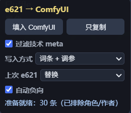

# e621 → ComfyUI Bridge

一个 Edge / Chromium 扩展：在 e621 帖子页读取标签，过滤角色和作者，把结果送到本机 ComfyUI 的 Furry 提示词插件。

> 非官方项目，与 e621、ComfyUI 或任何模型作者无关联。  
> e621 是 18+ 站点；本项目只处理标签，不包含或分发帖子图片。



## 功能

- 读取当前帖子的 tags。
- 排除 `artist`、`character`、`invalid`。
- 默认过滤技术性 meta，如 `hi_res`、`english_text`、`watermark`。
- 保留 `general`、`species`、`copyright`、`meta`、`lore`。
- 三种写入方式：
  - 词条 + 调参；
  - 只填词条；
  - 只调参数。
- 上次 e621：替换 / 追加。
- 自动负向。
- 一键填入本机 ComfyUI。
- 只复制到剪贴板，作为后端不可用时的回退。

## 安装

1. 打开 `edge://extensions/` 或 `chrome://extensions/`。
2. 开启“开发人员模式”。
3. 点击“加载解压缩的扩展”。
4. 选择本目录（包含 `manifest.json` 的目录）。
5. 打开或刷新一个 e621 帖子页。
6. 页面左下角应出现 `e621 → ComfyUI` 面板。

## 前提

- ComfyUI 运行在 `http://127.0.0.1:8188`。
- 已安装 [comfyui-furry-prompt](https://github.com/3WCOM17/comfyui-furry-prompt)。
- ComfyUI 启动时允许本地跨域，例如：

```bash
python main.py --enable-cors-header "*"
```

只建议本机使用，不要把 8188 暴露到公网。

## 行为说明

- “填入 ComfyUI”只向本机 `127.0.0.1:8188` 发送标签和 sample 图片 URL。
- 当写入方式启用 WD14 参数分析时，本机 ComfyUI 后端可能会临时下载 sample 图片用于本地分析，分析后删除；不上传到第三方。
- “只填词条”且关闭“自动负向”时，不需要进行图像分析。
- 扩展不会自动 Queue，也不会修改已保存的工作流文件。
- 扩展不读取 e621 Cookie，不需要账号密码，不上传账号信息。

## 过滤规则

排除：

```text
artist
character
invalid
```

保留：

```text
general
species
copyright
meta
lore
```

技术 meta 默认过滤，例如：

```text
hi_res
english_text
watermark
```

## 权限

`manifest.json` 只申请：

```text
https://e621.net/*
http://127.0.0.1:8188/*
clipboardWrite
storage
```

不申请全站访问权限，不包含远程代码。

## 隐私

- 无遥测。
- 无账号上传。
- 只访问 e621 和本机 ComfyUI。
- 详细说明见 [PRIVACY.md](PRIVACY.md)。

## 已知限制

- e621 页面结构变化可能导致面板失效。
- ComfyUI 未启动、CORS 未开启或插件未安装时，会退回复制到剪贴板。
- 当前只面向桌面 Edge / Chromium。
- 不处理登录、购买、下载或账号操作。

## License

MIT。e621 的帖子、图片、标签数据和角色语音不随本仓库分发，且不适用 MIT。

